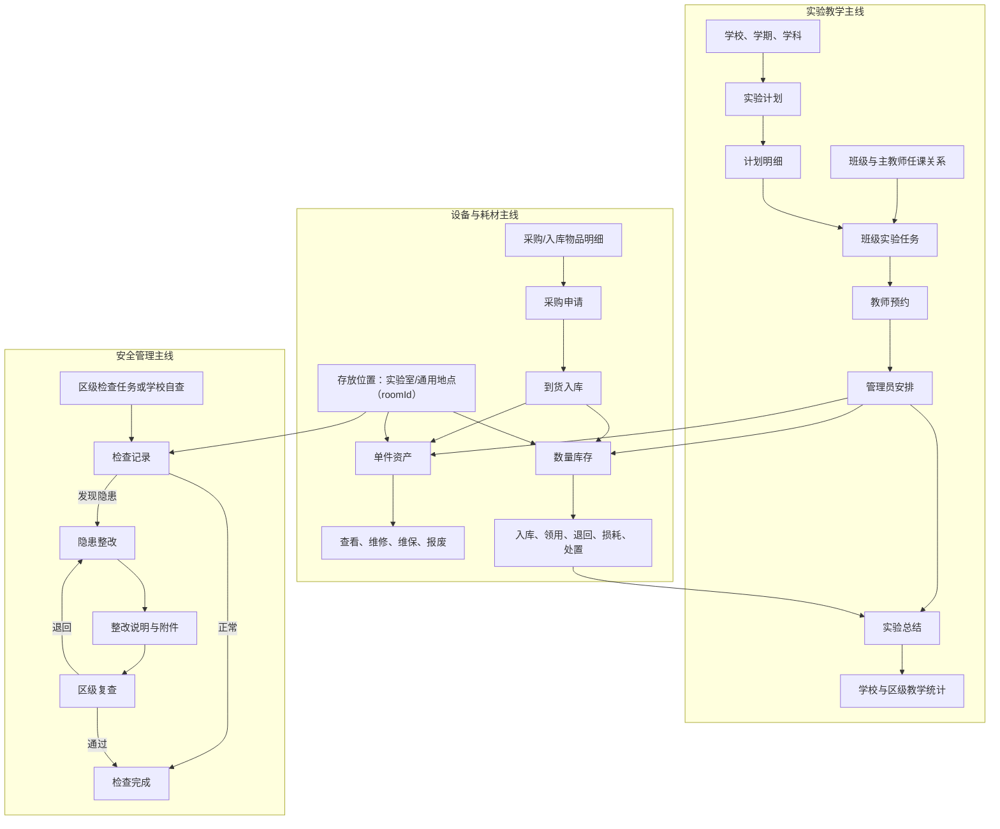
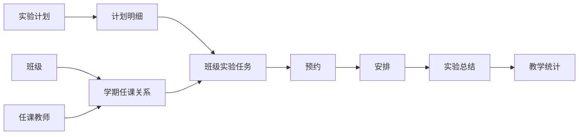
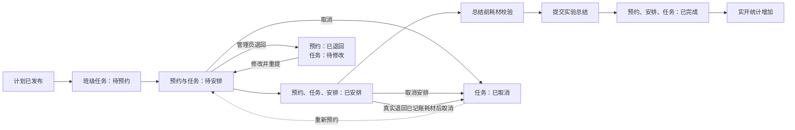
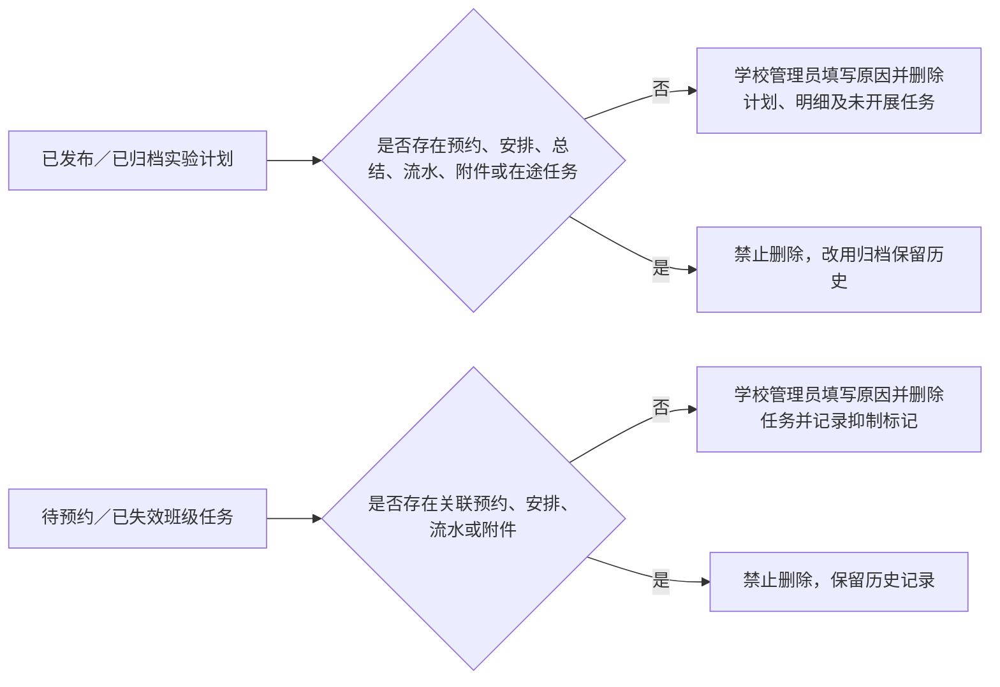
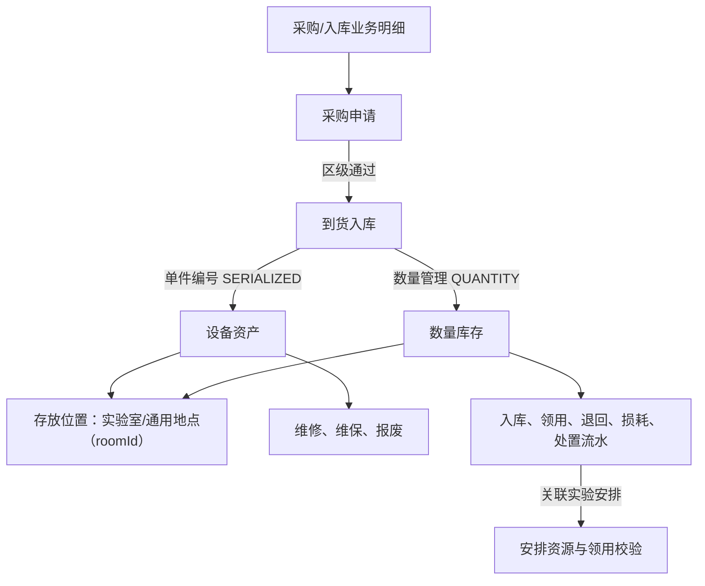
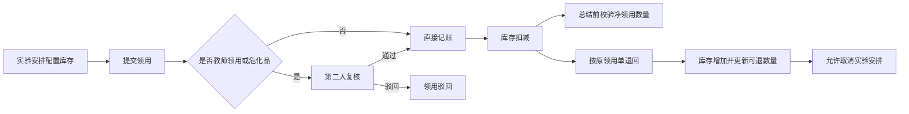
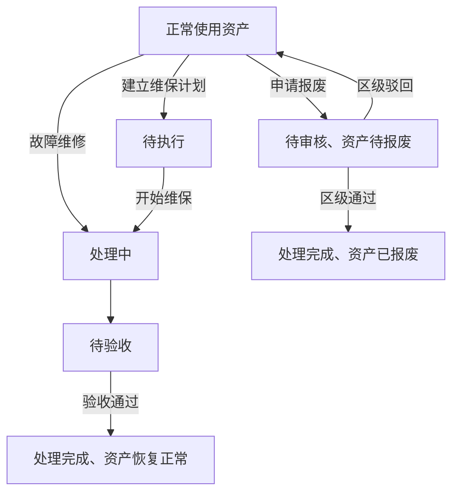
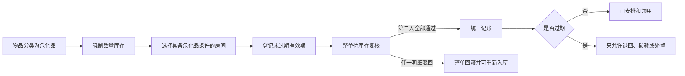
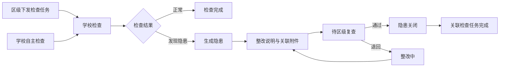

# 当前 Demo 业务流程与数据关系闭环评估报告

> 评估对象：`new-demo`  
> 评估日期：2026-09-02  
> 评估范围：物理实验室业务及学校、区级通用模块  
> 评估依据：当前可访问参考系统、现有 Demo 代码、表单、样例数据和自动化检查

## 一、评估结论

当前 Demo 已达到**演示级业务闭环与数据关系自洽**，可以用于业务流程演示、需求评审和原型验收。

主要教学、资源和安全业务已经具备：

- 明确的业务入口和责任角色；
- 清晰的数据来源与实体关系；
- 可追踪的状态变化；
- 正常完成出口；
- 退回、取消、驳回等异常出口；
- 业务日志、归档资料和统计汇总；
- 失败操作不污染原数据的事务性校验。

但该结论仅限于当前 Demo 的业务模型，**不能等同于生产系统已经闭环或具备上线条件**。服务端事务、并发控制、真实身份认证、批次库存、财务采购、不可篡改审计和外部系统集成仍未生产化。

| 评估维度 | 当前结论 | 说明 |
| --- | --- | --- |
| 实验教学主线 | 已闭环 | 计划、班级任务、预约、安排、总结和统计已贯通 |
| 设备与耗材主线 | 已闭环 | 采购/入库明细、设备台账、库存、领退和处理已贯通 |
| 危化品控制 | 演示级闭环 | 已有限定实验室/通用地点、有效期、双人复核和过期清退，但不是正式合规系统 |
| 安全检查整改 | 已闭环 | 检查任务、检查记录、隐患、整改附件、复查和关闭已贯通 |
| 主数据、归档和日志 | 基本闭环 | 具备引用锁、业务附件和操作日志 |
| 区级数据上报 | 仅演示快照 | 当前只有学校上报，没有区级接收、退回、更正和锁定流程 |
| 生产级平台能力 | 未生产化 | 当前仍是浏览器本地数据与演示身份体系 |

## 二、闭环判定口径

本报告按以下七项标准判断一条业务链是否闭环：

1. **来源明确**：业务记录能追溯到主档或上游单据。
2. **责任明确**：创建、审核、执行、复核等角色边界清楚。
3. **状态明确**：每一步都有合法前置状态和目标状态。
4. **正常终态明确**：业务能够到达完成、关闭、归档或已记账状态。
5. **异常出口明确**：具备退回、驳回、取消、撤销或差异处理路径。
6. **数据回写明确**：下游操作能够正确更新任务、库存、资产或统计。
7. **历史可追溯**：保留来源关系、业务单据、附件或操作日志。

## 三、总体业务架构



### 3.1 当前模型的五项核心设计原则

界面归属口径：学校端“实验室”页只承载实验室档案；“班级管理”和“任课教师设置”统一位于“人员管理”页，任课班级从任课教师列表进入设置。底层仍使用 `rooms`/`roomId` 表达实验室、准备室、仪器室、普通教室等通用地点，因此下文涉及存放位置时保留“房间”这一数据模型术语。

1. **计划自包含且和班级解耦**：计划头与计划明细直接保存学校实验名称、章节、教材范围、器材需求和课时，不直接保存班级或任课教师。
2. **申请和执行解耦**：预约只表达教师需求，管理员安排才确定实验室/通用地点、实验负责人、最终时段和具体资源。
3. **明细与台账一致**：物品名称、规格、分类和管理方式直接保存在采购、入库、资产和库存明细中，后续业务保留当时快照。
4. **存放位置统一由 `roomId` 表达**：当前 Demo 不显示、不保存橱柜和层次；学校端主档入口命名为“实验室”，设备和库存仍统一关联 `roomId`。
5. **学校职责合并**：学校管理员同时承担设备、库存、实验安排协同和安全检查职责，不再设置独立实验员角色。

参考系统当前部署仍存在橱柜相关页面；Demo 按已确认口径统一为单层存放位置，界面主档称为“实验室”，底层仍以 `rooms`/`roomId` 表达地点。删除橱柜是本项目主动选择，不属于漏做功能。

## 四、实验教学业务闭环

### 4.1 教学数据关系



计划头保存学校、学期、学科、适用年级、教材版本、计划名称、发布状态和创建审计字段；计划明细直接保存实验名称、章节、器材需求、课时、必做/选做、分组/演示及建议时间。班级与任课教师来自学期任课关系，计划不直接关联班级。

系统按“计划明细 × 匹配年级的有效主教师任课关系”生成班级实验任务。协同教师不会重复生成任务，同一学期、班级和学科只能存在一个有效主教师。

### 4.2 正常状态流



### 4.2.1 删除与归档分支



参考系统的物理实验流程在“安排实验”后直接进入“登记实验总结”，没有独立的“准备”页面、准备确认按钮或“已准备”状态。本 Demo 已按该口径收敛：安排完成即进入“待登记总结”，资源和耗材校验分别在安排提交及总结提交前完成。

#### 4.2.1 “预约与安排”模块页签

Demo 将参考系统中的预约、安排和总结待办保留在一个“预约与安排”模块内，通过六个页签切换视图。页签是同一台账的筛选条件，不是六套业务流程：

| 页签 | 过滤逻辑 | 业务用途 |
| --- | --- | --- |
| 已预约实验 | 有效预约状态为“待安排”或“已退回” | 管理员接收和处理预约申请 |
| 已安排实验 | 关联安排存在且未取消 | 查看当前安排及已完成历史 |
| 待登记总结实验 | 关联安排为“已安排”，且没有对应实验总结 | 安排完成后的总结待办 |
| 我预约的实验 | 当前账号为 `applicantId`，且预约为“待安排”或“已退回” | 查看本人待处理预约 |
| 我的已安排实验 | 当前账号为安排记录的 `technicianId` 或 `arrangedBy` | 查看本人负责或经办的安排 |
| 我的待登记总结实验 | 同时满足“我的已安排实验”和“待登记总结实验” | 查看本人总结待办 |

已完成记录不另建“完成记录”页签，而是保留在“已安排实验／我的已安排实验”中，用状态筛选查看。这样既与参考系统的六类查询口径对应，又避免为了列表展示新增冗余状态或表单。

### 4.3 各环节职责与闭环控制

| 环节 | 主要输入 | 主要输出 | 闭环控制 |
| --- | --- | --- | --- |
| 编制计划 | 当前学校、学期、学科、年级、教材、实验名称、章节、器材需求、课时 | 计划头与计划明细 | 周次或日期二选一；不直接关联班级和教师 |
| 生成任务 | 已发布计划明细、有效主教师任课关系 | 班级实验任务 | 年级匹配；协同教师不重复生成 |
| 教师预约 | 班级任务、申请日期、节次、分组、物品类型需求 | 待安排预约 | 可动态新增/删除计划外物品需求；不提前保存房间、实验负责人、最终时段和具体库存 |
| 管理员安排 | 预约、可用房间、节次、人员和资源 | 实验安排 | 校验容量、学科、连续课时及房间、班级、教师、实验负责人、设备冲突 |
| 安排与总结前校验 | 预约、可用房间、负责人、具体资源；如有数量型耗材则关联领用流水 | 已安排实验 | 安排时确认房间、负责人和资源；数量型耗材须在总结前完成关联领用并记账 |
| 实验总结 | 已安排实验、实际日期、效果、改进、设备情况、图片 | 实验总结与已完成任务 | 总结只完成班级任务，不把计划改成“已完成” |
| 统计 | 非失效班级任务、计划明细属性、总结结果 | 应开、实开和完成率 | 只有已完成任务计入实开 |

预约表单的“补充器材需求”默认提供一行空白明细，教师可继续添加或删除行，逐行选择设备／耗材明细并填写数量。该需求只登记物品类型和数量，不提前绑定设备资产、库存余额、房间或库存占用；管理员在安排阶段再把需求落实为当前可用的实际资源。

### 4.4 异常出口

- **退回重提**：管理员退回预约后，教师可修改申请日期、节次、分组数、补充器材需求和备注，再次提交。
- **取消预约**：待安排或已退回预约可以取消，任务置为“已取消”并可重新预约，不从应开统计中消失。
- **已安排实验取消**：未记账领用自动撤销；已经记账的领用必须足量真实退回后才能取消，损耗、处置或伪造来源不能代替退回。
- **计划归档**：存在待安排、待修改或已安排任务时禁止归档；未开展任务失效，已完成历史保留。
- **计划／任务删除**：学校管理员可删除没有预约、安排、总结、库存流水或附件的计划，以及无关联业务的“待预约／已失效”任务；只要存在执行痕迹就阻止删除，改用归档保留历史。
- **班级或任课关系停用**：有在途任务时禁止；没有在途任务时，未开展任务失效，已完成历史保留。

### 4.5 教学闭环结论

教学主线在 Demo 口径内已经闭环，没有发现正常流程无法到达终态、退回后不能继续、取消后数据悬挂或统计重复的问题。

需要特别说明：当前计划保存即发布，没有草稿、计划审批和版本修订；这属于 Demo 简化，不影响当前演示链路，但正式系统需要补充。

## 五、设备、耗材与危化品业务闭环

### 5.1 资源主线



### 5.2 业务明细与入库分流

- 采购、入库、设备台账、库存和预约明细直接保存物品字段；不设置独立物品主档页面。
- 单件编号物品入库后生成独立资产卡。
- 数量管理物品入库后建立或合并“学校＋物品＋房间”库存余额。
- 采购阶段不填写存放房间和维保日期；到货时才补充实际房间、维保日期和数量库存有效期。
- 入库未指定房间时，单件资产进入“待存放”，数量库存进入“待分配”。
- 采购单当前按整单到货，不支持部分收货。

### 5.3 实验室/通用地点存放

设备和库存都只通过 `roomId` 关联存放位置；学校端对应“实验室”页的档案。位置在入库时直接记录，未填写时保留待存放或待分配状态。

| 业务 | 数据变化 | 业务凭证 | 关键拦截 |
| --- | --- | --- | --- |
| 入库存放 | 写入资产/库存 `roomId`；空值保留待存放/待分配 | 入库单和台账记录 | 房间不可用、学科或危化品条件不符合 |
| 位置状态 | 资产/库存状态同步反映待存放、待分配、正常使用或在库 | 操作日志 | 待复核和处理单状态 |


### 5.4 领用与真实退回



退回是唯一可以保存 `sourceFlowId` 的库存业务。系统校验退回来源、库存、日期、数量，并继承原领用单的实验安排和班级任务关系。

### 5.5 维修、维保和报废



维保计划和实际执行已经分离：建立计划时不占用资产，开始维保后资产才进入维修中状态。设备处理会校验当前状态，避免一个流程覆盖另一个流程的结果。

### 5.6 危化品专项控制



当前危化品控制在 Demo 口径内闭环，但数量库存仍按“物品＋房间＋一个保守有效期”汇总，没有批次号、FEFO、SDS、相容性和监管台账，因此不能表述为已经满足正式危化品合规要求。

## 六、安全管理与通用模块闭环

### 6.1 安全检查整改



### 6.2 通用模块

| 模块 | 已形成的关系或控制 | 当前结论 |
| --- | --- | --- |
| 学校、部门、人员 | 人员归属部门，角色和学科被任课及任务引用后受限 | 基本闭环 |
| 实验室档案（实验室页） | 实验室与资产、库存、安排、检查记录通过 `roomId` 关联；在途业务和库存引用限制主档修改 | 已闭环 |
| 班级管理与任课教师设置（人员管理页） | 班级名称校内唯一；任课班级设置按学期管理 | 已闭环 |
| 学期与节次 | 节次按“学校＋学期”分版，同版编号和时间不可冲突 | 已闭环 |
| 资料归档 | 附件关联具体业务记录，教师只能上传本人可见业务资料 | 演示级闭环 |
| 操作日志 | 创建、状态变化、复核和迁移均保留记录 | 演示级闭环 |
| 数据上报 | 保存当前学期指标和数据版本快照 | 单向演示，未形成区级反馈闭环 |

## 七、核心数据关系

### 7.1 ER 关系图

```mermaid
erDiagram
  SCHOOL ||--o{ ROOM : owns
  SCHOOL ||--o{ STAFF : employs
  SCHOOL ||--o{ CLASS : manages
  SCHOOL ||--o{ PERIOD : configures
  SCHOOL ||--o{ PLAN : creates
  TERM ||--o{ PERIOD : defines
  TERM ||--o{ ASSIGNMENT : scopes
  TERM ||--o{ PLAN : scopes

  CLASS ||--o{ ASSIGNMENT : has
  STAFF ||--o{ ASSIGNMENT : teaches
  PLAN ||--|{ PLAN_ITEM : contains
  PLAN_ITEM ||--o{ TEACHING_TASK : generates
  ASSIGNMENT ||--o{ TEACHING_TASK : generates

  TEACHING_TASK ||--o{ BOOKING : keeps_history
  BOOKING ||--o| ARRANGEMENT : becomes
  ARRANGEMENT ||--o| SUMMARY : produces

  PURCHASE ||--o{ RECEIPT : becomes
  RECEIPT ||--o{ ASSET : creates
  RECEIPT ||--o{ INVENTORY : creates_or_updates
  ROOM ||--o{ ASSET : stores
  ROOM ||--o{ INVENTORY : stores
  ASSET ||--o{ REPAIR : handles
  INVENTORY ||--o{ FLOW : posts
  ARRANGEMENT ||--o{ FLOW : issues

  ROOM ||--o{ CHECK : inspected_in
  CHECK ||--o{ HAZARD : discovers
  HAZARD ||--o{ ARCHIVE : evidences
```

### 7.2 关键基数与唯一性约束

| 关系 | 基数或约束 | 设计意义 |
| --- | --- | --- |
| 计划 → 计划明细 | 1:N | 计划头保存范围信息，明细保存可独立还原的实验字段 |
| 计划明细 × 主教师任课关系 → 班级任务 | 派生关系 | 班级和教师不直接污染计划头 |
| 班级任务 → 预约 | 1:N 历史，最多一个有效预约 | 支持取消、重提和历史留痕 |
| 预约 → 安排 | 0..1 | 未安排申请不提前产生执行数据 |
| 安排 → 总结 | 0..1 | 防止重复总结和重复完成统计 |
| 设备／耗材明细 → 资产/库存 | 1:N | 入库和台账直接保存物品字段，后续业务保留当时快照 |
| 实验室/通用地点（`rooms`） → 资产/库存 | 1:N | 存放位置统一由 `roomId` 表达，不存在橱柜或层次关系 |
| 学校＋物品＋`roomId` → 库存余额 | 唯一 | 避免同一地点出现重复余额 |
| 原领用流水 → 退回流水 | 1:N，累计不得超原领用 | 保证真实退回和净领用统计 |
| 学校＋学期＋节次编号 | 唯一且时间不重叠 | 保证预约和安排时间口径一致 |
| 学校＋班级名称 | 唯一 | 防止任务和统计错误合并 |
| 学期＋班级＋学科 | 最多一个有效主教师 | 防止同一班级重复生成实验任务 |

### 7.3 当前仍使用内嵌关系的部分

预约需求和安排资源目前以明细数组保存在业务单内：

- 预约需求：`itemId + qty`；
- 实际安排：具体资产或库存 `ref + qty`；
- 采购和入库：单据明细数组。

这在 Demo 中能够保持逻辑自洽。正式系统建议拆分为单据头、单据明细和资源占用表，以支持数据库约束、并发占用、分批处理和审计查询。

## 八、表单字段职责是否合理

| 表单 | 用户填写 | 系统自动写入或带出 | 明确不应填写 |
| --- | --- | --- | --- |
| 实验计划 | 计划名称、适用年级、教材版本、实验名称、章节、器材需求、课时、实施方式、周次或日期 | 学校、学期、学科、创建人、发布时间、发布状态 | 班级、任课教师、完成状态 |
| 实验预约 | 班级实验任务、申请日期、节次、分组数、物品类型需求、备注 | 班级、教师、学期、申请人、班级人数快照 | 实验室、最终时段、实验负责人、具体资产或库存 |
| 实验安排 | 最终日期、连续节次、地点类型、实验室/通用地点、实验负责人、具体资源、说明 | 预约和计划上下文 | 再次录入班级、任课教师或计划字段 |
| 入库 | 供应商、日期、明细物品字段、数量与单价、存放位置、条件化维保日期/有效期 | 单号、经手人、总价 | 橱柜、层次和重复录入的主档字段 |
| 数量库存 | 分类编号、名称、规格、分类、单位、管理方式、补库阈值、初始存放位置、条件化有效期 | 当前库存和管理类别 | 期初库存、危化品布尔值 |
| 实验总结 | 实际日期、实验效果、改进意见、设备情况、备注、图片 | 班级、教师、实验和提交人 | 计划完成状态 |

当前字段分工总体合理，申请字段、执行字段、主档字段和系统审计字段已经分离。

## 九、闭环审计矩阵

| 业务链 | 来源 | 状态流 | 正常终态 | 异常出口 | 追溯/统计 | 结论 |
| --- | --- | --- | --- | --- | --- | --- |
| 实验教学 | 满足 | 满足 | 任务已完成 | 退回、取消、失效 | 总结、日志、教学统计 | 已闭环 |
| 计划归档 | 满足 | 满足 | 已归档 | 在途任务阻断 | 历史任务保留 | 已闭环 |
| 计划／任务删除 | 满足 | 满足 | 删除并记录原因 | 执行记录或历史引用阻断 | 日志保留删除轨迹；有痕迹改用归档 | 已闭环 |
| 采购入库 | 满足 | 满足 | 已入库 | 驳回、撤销、整单回滚 | 采购、入库、资产/库存、流水 | Demo 闭环 |
| 资产运行 | 满足 | 满足 | 正常/处理完成/已报废 | 驳回、撤销、状态冲突 | 设备台账、处理单 | 已闭环 |
| 数量库存 | 满足 | 满足 | 已记账/已复核 | 驳回、退回 | 流水、日志 | 已闭环 |
| 危化品 | 满足 | 满足 | 已记账或完成清退 | 第二人驳回、过期阻断、整单回滚 | 有效期、房间、复核记录 | 演示级闭环 |
| 安全整改 | 满足 | 满足 | 隐患关闭、任务完成 | 复查退回整改 | 检查、隐患、附件、日志 | 已闭环 |
| 数据上报 | 满足 | 单向 | 已上报快照 | 无区级退回更正 | 保存版本和指标快照 | 未完全闭环 |

## 十、尚未生产化的边界

### 10.1 平台基础能力

- 当前数据存放于 `localStorage/sessionStorage`，没有服务端数据库事务和并发锁。
- 当前角色可以免密切换，不是真实认证、授权和租户隔离。
- 操作日志可用于演示追踪，但不是不可篡改审计日志。
- `TODAY` 使用固定演示日期，提醒、逾期和有效期判断尚未使用可信服务器时间。

### 10.2 教学业务

- 计划保存即发布，没有草稿、审核、修订版本和变更影响分析。
- 应开统计来自学校已发布计划；学校未编入计划的必做实验不会自动进入应开分母。
- 已安排后直接通过总结完成，没有到课人数、实际分组、部分完成和异常执行结构。
- 安排修改主要通过取消后重建，总结提交后没有受控更正和修订版本。
- 历史页面仍可能实时读取班级名称、教师姓名等主档，正式审计建议增加业务快照或主档有效期版本。

### 10.3 采购、库存和资产

- 采购只支持整单一次到货，没有部分收货、欠交、退供、合同、预算、发票和正式质检。
- 数量库存按“物品＋房间”汇总，不是批次库存，没有批号、生产日期、批次价格、FEFO和召回追溯。
- 当前不提供跨房间转移和设备借用归还业务；资产/库存位置在入库时直接记录。
- 维修维保没有自动周期工单、SLA、配件工时和服务商合同；报废没有技术鉴定、残值和财务核销。
- 计划明细的器材需求目前为学校填写的文本，没有结构化实验 BOM、替代关系、计量校准和标准耗用定额；预约可另加设备／耗材明细中的补充器材需求。

### 10.4 危化品与附件

- 危化品缺少正式批次、SDS、相容性分类、最大存量、领用签名、环境监测和处置联单。
- 当前不恢复橱柜字段，但生产监管可能需要房间内分区或专用存放单元；应另行设计，不应重新使用含义模糊的“橱柜或房间”。
- 附件当前为浏览器本地小文件，没有对象存储、病毒检测、电子签章和长期归档能力。

### 10.5 集成和验收

- 尚未接入教务课表、统一身份、财务、资产、教育监管、条码/RFID或消息通知系统。
- 自动化检查不等于多用户并发、安全、性能、兼容性和真实用户验收。

## 十一、生产化建议优先级

| 优先级 | 建议 | 解决的问题 |
| --- | --- | --- |
| P0 | 服务端数据库、真实身份认证、权限模型、事务与并发锁、可信时间、不可篡改审计 | 平台可用性和数据可信度 |
| P0 | 危化品批次、有效期、FEFO、SDS、相容性和监管记录 | 危化品正式管理 |
| P0 | 将预约需求、安排资源、采购/入库明细拆为正式明细表和占用表 | 并发占用和数据库约束 |
| P1 | 计划草稿、审核、版本修订、变更影响和统计冻结 | 教学计划治理 |
| P1 | 部分收货、退供和库存冲销 | 资源业务完整性 |
| P1 | 结构化实验 BOM、替代器材、定额、计量校准 | 安排与耗材核验精细化 |
| P1 | 对象存储、附件病毒检测、电子签章和长期归档 | 证据可信度 |
| P2 | 教务、统一身份、财务资产、监管、扫码和消息平台集成 | 跨系统协同 |

## 十二、验收建议

### 12.1 可以通过的范围

- 业务流程演示；
- 数据关系评审；
- 主要角色权限和表单职责评审；
- 教学、资源、安全主线的原型验收；
- 下一阶段产品需求确认。

### 12.2 不能据此通过的范围

- 生产上线验收；
- 危化品合规验收；
- 数据安全和等保验收；
- 财务和国有资产管理验收；
- 多用户并发、性能和稳定性验收；
- 正式监管统计口径验收。

## 十三、验证依据

本轮复核结果：

- 核心 JavaScript 文件 `mock-data.js` 和 `app.js` 通过语法检查；
- `tests/check-demo.cjs` 已通过当前 v9 回归：38 组业务检查通过，113 个角色/页面/标签页渲染组合通过；
- 已同步验证实验计划、预约、安排、实验室/通用地点存放、危化品有效期以及设备台账、维修报废等关键状态出口；当前仍不替代服务端集成测试、安全测试、性能测试和用户验收。

上述结果说明当前 Demo 的文档、核心脚本和自动化回归已与 v9 流程一致；它们也不替代服务端集成测试、安全测试、性能测试和用户验收。

## 十四、最终结论

**当前 Demo 的主要业务流程和数据关系已经闭环。**

更准确的表述是：

> 当前版本已达到“演示级业务闭环、主要数据关系自洽、异常路径可返回或终止”的水平，可以作为物理实验室及通用模块的业务原型；尚未达到“生产级、监管级、财务级和合规级完整闭环”。

## 附：评估文件

- [业务模型与事务实现](./assets/mock-data.js)
- [页面、表单与交互实现](./assets/app.js)
- [自动化检查](./tests/check-demo.cjs)
- [字段对照清单](./字段对照清单.md)
- [Demo 使用说明](./README.md)
