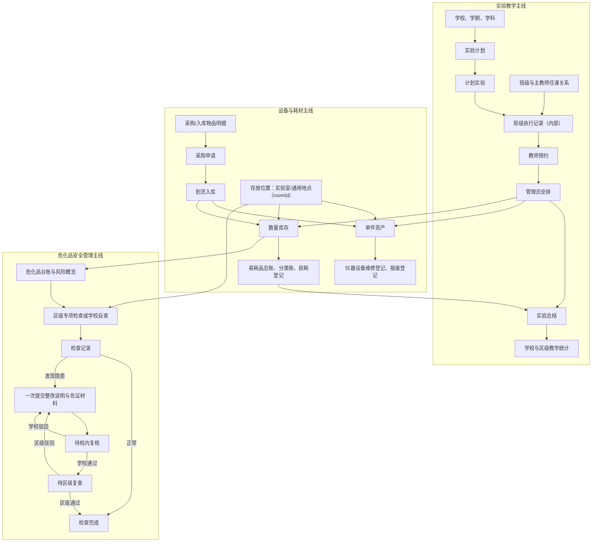
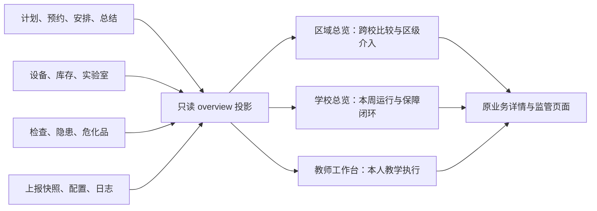
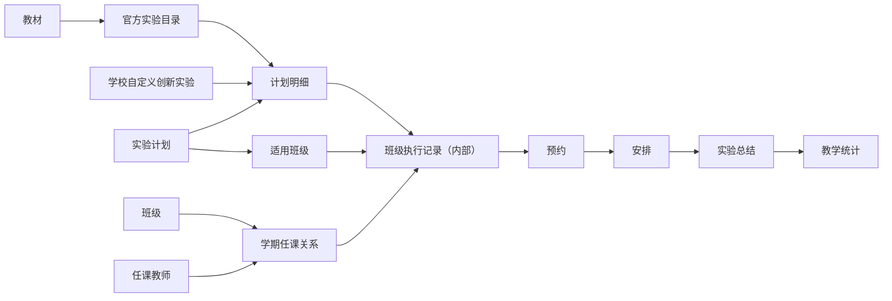
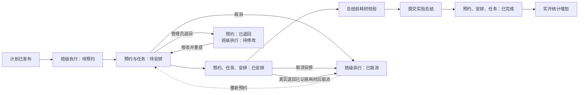
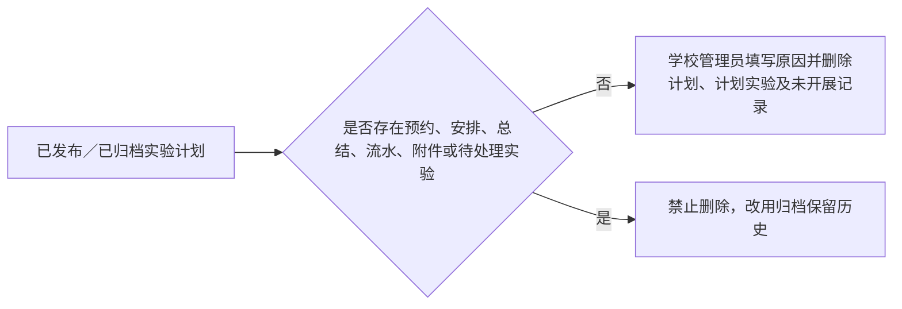
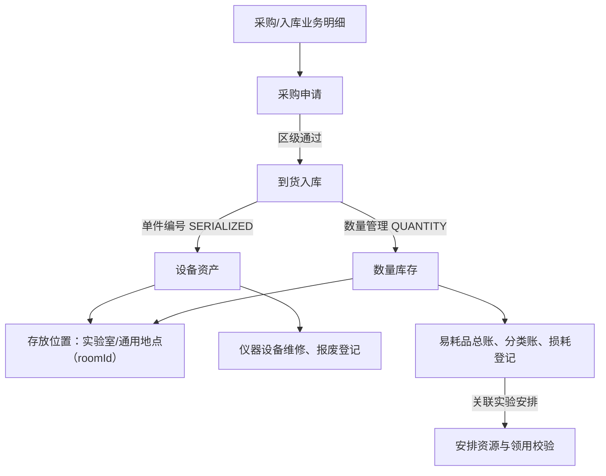
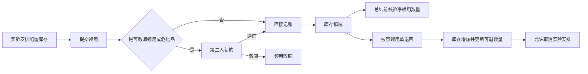
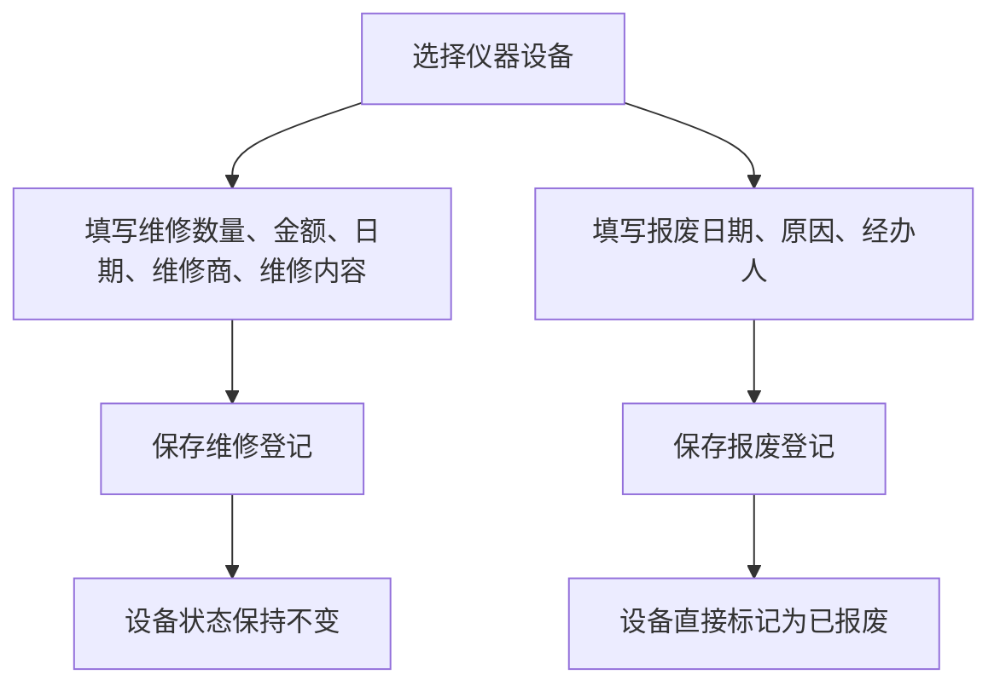
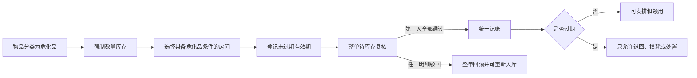
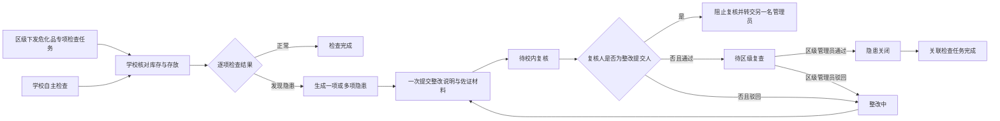

# 当前 Demo 业务流程与数据关系闭环评估报告

> 评估对象：`new-demo`  
> 评估日期：2026-09-07
>
> 评估范围：科学、物理、化学、生物学四学科实验教学及学校、区级通用模块
>
> 评估依据：当前可访问参考系统、现有 Demo 代码、表单、样例数据和自动化检查

## 一、评估结论

当前 Demo 已达到**演示级业务闭环与数据关系自洽**，可以用于科学、物理、化学、生物学四学科的业务流程演示、需求评审和原型验收。四学科复用同一套导航、表单、台账和统计链路，不复制四套业务模块。

主要教学、资源和安全业务已经具备：

- 明确的业务入口和责任角色；
- 清晰的数据来源与实体关系；
- 可追踪的状态变化；
- 正常完成出口；
- 退回、取消、驳回等异常出口；
- 业务日志、归档资料和统计汇总；
- 管理员对错误数据的受控更正、删除和状态回退；
- 失败操作不污染原数据的事务性校验。

但该结论仅限于当前 Demo 的业务模型，**不能等同于生产系统已经闭环或具备上线条件**。服务端事务、并发控制、真实身份认证、批次库存、财务采购、不可篡改审计和外部系统集成仍未生产化。

| 评估维度 | 当前结论 | 说明 |
| --- | --- | --- |
| 四学科作用域 | 已闭环（Demo） | 稳定学科代码、顶部“学科范围”、角色可见范围、上下游继承和器材兼容校验已贯通 |
| 两级总览与教师工作台 | 已实现（Demo） | 区域按校监管、学校运行保障、教师个人执行三种视图已接入同源台账，并可下钻原始记录 |
| 实验教学主线 | 已闭环 | 计划、班级执行记录、预约、安排、总结和统计已贯通 |
| 设备与耗材主线 | 已闭环 | 采购/入库明细、设备台账和实验领退保持原链路；房间与橱柜两级存放、位置调整记录、易耗品账目及维修报废均已接入 |
| 危化品控制 | 演示级闭环 | 已有限定实验室/通用地点、有效期、双人复核和过期清退，但不是正式合规系统 |
| 危化品安全管理 | 已闭环（Demo） | 页面已收拢为待办、危化品台账、检查与整改三个入口；风险提示、专项检查、隐患、整改材料、校内复核、区级复查和关闭已贯通 |
| 主数据、归档和日志 | 已闭环（Demo） | 具备受保护的改删、引用锁、业务附件、关系审计和操作日志 |
| 区级数据上报 | 仅演示快照 | 当前只有学校上报，没有区级接收、退回、更正和锁定流程 |
| 生产级平台能力 | 未生产化 | 当前仍是浏览器本地数据与演示身份体系 |

## 二、闭环判定口径

本报告按以下七项标准判断一条业务链是否闭环：

1. **来源明确**：业务记录能追溯到主档或上游单据。
2. **责任明确**：创建、审核、执行、复核等角色边界清楚。
3. **状态明确**：每一步都有合法前置状态和目标状态。
4. **正常终态明确**：业务能够到达完成、关闭、归档或已记账状态。
5. **异常出口明确**：具备退回、驳回、取消、撤销或差异处理路径。
6. **数据回写明确**：下游操作能够正确更新任务、库存、资产或统计。
7. **历史可追溯**：保留来源关系、业务单据、附件或操作日志。

## 三、总体业务架构



### 3.1 当前模型的六项核心设计原则

界面归属口径：学校端“实验室档案”页只承载实验室档案；“班级管理”和“任课教师设置”统一位于“人员与班级”页，任课班级从任课教师列表进入设置。底层仍使用 `rooms`/`roomId` 表达实验室、准备室、仪器室、普通教室等通用地点，因此下文涉及存放位置时保留“房间”这一数据模型术语。

学校端的业务表单、列表和详情均以当前登录学校为固定作用域，不再展示“学校”选择字段或学校列；学校归属由当前账号上下文自动写入，跨校选择仅属于区级端。

1. **计划自包含且和班级解耦**：计划头与计划明细直接保存学校实验名称、章节、教材范围、器材需求和课时，不直接保存班级或任课教师。
2. **申请和执行解耦**：预约只表达教师需求，管理员安排才确定实验室/通用地点、实验负责人、最终时段和具体资源。
3. **明细与台账一致**：物品名称、规格、分类和管理方式直接保存在采购、入库、资产和库存明细中，后续业务保留当时快照。
4. **存放位置采用房间＋橱柜两级表达**：学校端主档入口命名为“实验室”，橱柜在房间下独立维护；设备和库存保存 `roomId`，分配柜位时同时保存 `cabinetId`，不实现柜内层次。
5. **学校职责合并**：学校管理员同时承担设备、库存、实验安排协同和安全检查职责，不再设置独立实验员角色。
6. **四学科共用业务模型**：科学、物理、化学、生物学是并列业务学科，通过统一的“学科范围”缩小当前工作集，不将“科学”当作其他三科的父级，也不把“全部学科”或“通用”写入学科业务字段。

参考系统当前部署仍存在橱柜相关页面；Demo 已将其收敛为房间下的橱柜主档和柜级库存维度，界面主档称为“实验室”，底层以 `rooms`/`roomId` 与 `cabinets`/`cabinetId` 表达地点。柜卡按当前台账动态生成 HTML；柜内层次和二维码仍不作为本轮数据字段。

### 3.2 导航信息架构

区级导航按监管对象拆为“工作台、组织与配置、教学监管、资产监管、安全监管”，其中“实验计划监管”用于追溯计划和各班执行情况，“实验开出统计”用于查看进度、排名、学科、年级和班级统计。学校管理员按业务执行顺序拆为“工作台（含教学资源库）、教学运行、资产物资、安全管理、基础设置”。

任课教师沿用学校端业务页面，但隐藏“危化品安全管理”“实验室档案”“人员与班级”三个纯管理入口，保留教学运行、资产物资和教学资源库。教学资源库使用独立资源记录，直接访问页面时仍由原角色权限规则限制操作。

### 3.3 两级总览的信息架构与数据口径

总览不建立新的持久化汇总表，而是把已有业务台账组织成三种决策视图：



| 视图 | 主要回答的问题 | 核心内容 | 范围约束 |
| --- | --- | --- | --- |
| 区域总览 | 哪些学校、哪些事项需要区级介入 | 必做开出率、需关注学校、教学超期、采购与整改复查待办、上报异常；学校教学与风险态势；区域资源、安全、配置与上报质量 | 可选全部学校或单校，服从学期与教学学科；安全数据跨学科共享 |
| 学校总览 | 本校今天、本周应保障和处理什么 | 最终安排日程、待安排与待总结、分学科教学进度、资源异常、安全闭环、配置缺口和上报状态 | 固定当前学校；教学与资源服从学科，安全固定全校口径 |
| 教师工作台 | 本人下一步要上什么实验、补什么记录 | 本人开出率、本周安排、退回预约、待登记总结、计划超期和按班级执行进度 | 固定本人任课、预约、安排和总结链，不返回学校管理类数据 |

区域学校态势不是单一综合分。页面并列展示教学、资源、安全、配置和上报事实，并把存在任一异常或上报不及时的学校标记为“需关注”，避免不可解释的加权排名。学校待办按逾期、今日、三天内和普通事项排序；区级待办只纳入区级有权处理的采购审批与待区级复查隐患；教师待办只纳入本人被退回预约和待登记总结。

必做开出率的分母来自当前范围内已发布计划形成的必做班级执行记录，提交实验总结并同步到“已完成”后计入分子。本周实验使用管理员最终安排日期，而不是教师申请日期。上报异常通过最新 `submissions` 快照和其后的业务日志变化判断；配置质量从任课、计划、适用班级、计划明细、启用节次和实验室关键档案缺口派生。所有卡片与下钻列表共用同一批筛选后记录，并显示统计日期、周次、周范围和数据版本。

### 3.4 四学科字典、顶部范围与角色权限

四个学科建立稳定代码映射；当前兼容模型仍以规范化中文值为主字段，并并行保存代码：

| 稳定代码 | 兼容存储值 | 界面统一显示 | 可识别历史别名 |
| --- | --- | --- | --- |
| `SCI` | 科学 | 科学 | 科学 |
| `PHY` | 物理 | 物理 | 物理 |
| `CHEM` | 化学 | 化学 | 化学 |
| `BIO` | 生物 | 生物学 | 生物、生物学、生命科学 |

为兼容旧版本，Demo 业务记录仍保留规范化后的中文 `subject`，同时补写 `subjectCode`；列表、详情、统计和选项统一通过学科字典显示，因此 `BIO` 始终呈现为“生物学”。`ALL` 仅是界面中的“全部学科”查询值，“综合”仅表示演示教师可跨学科任教，两者都不是第五个业务学科。

学科与学段、年级是两个独立维度：“科学”不是物理、化学、生物学的父级，也不因小学常用综合科学课程就自动包含后三科。学校实际在小学、初中或高中开设哪个学科，应由“学校＋学段＋年级＋学期＋学科”的开课配置决定；当前 Demo 中的高中科学样例只用于验证四学科共用链路，不作为正式课程方案依据。

工作台、智能问数、实验计划、预约与安排、实验开出统计、教学资源库、设备物资、维修报废和实验室档案页面，在页面顶部上下文栏共用同一个“学科范围”；选中具体学科时，面包屑也显示当前学科。危化品安全管理属于跨学科共享业务，不显示无实际效果的学科切换；学校档案、人员与班级、学年学期和平台设置等共享主数据也不强制切分为四套。

| 角色 | 学科范围 | 操作边界 |
| --- | --- | --- |
| 区级管理员 | 四学科或“全部学科” | 可跨校查看与统计；采购审批、安全复查等操作仍按原角色和业务状态校验 |
| 学校管理员 | 本校四学科或“全部学科” | 学科切换只缩小工作范围，不突破本校数据边界和管理员操作权限 |
| 任课教师 | 由当前学期的有效任课关系和本人专业学科确定 | 只有一个可用学科时显示锁定标签；多学科教师只能在本人可用学科间切换，且列表和操作仍限本人计划、任务和业务记录 |

学科范围按“端别＋学校＋账号”保存为会话偏好，跨页复用；首次进入时区级和学校管理员默认“全部学科”，教师默认本人的第一个有效学科。切换学期后如原学科不再属于教师当期可用范围，则回到本人的第一个有效学科。学科范围是查询和工作上下文，不代替学校、角色、本人数据范围及业务状态校验。

## 四、实验教学业务闭环

### 4.1 教学数据关系



计划头保存学校、学期、学科、适用年级、教材版本、教材、计划名称和发布审计字段；计划明细从官方教材实验目录或学校自定义创新实验中选择，并保存必做/选做/创新实验属性、来源及器材快照。适用班级通过独立的 `planTargets` 关系明确关联，任课教师仍来自学期任课关系。

系统按“计划适用班级 × 匹配年级的有效主教师任课关系”建立内部班级执行记录。该记录不作为独立业务页签，用户在实验计划详情中查看各班进度并发起预约。协同教师不会重复形成应开次数，同一学期、班级和学科只能存在一个有效主教师；计划没有显式班级范围的历史数据继续按同年级关系兼容建立。

学科在教学链中遵循单向继承，不在每个下游表单重复让用户选择：

```text
教材／官方实验目录／学校自定义实验
  → 实验计划
  → 计划实验
  → 班级执行记录（内部）
  → 预约
  → 安排
  → 实验总结
```

计划编制时校验教材、实验目录、年级和学科一致；建立班级执行记录时再校验计划学科与有效任课关系一致。预约从班级执行记录、安排从预约、总结从安排自动继承 `subject/subjectCode`，不允许在下游改科。这些下游学科字段用于稳定筛选和历史追溯，其权威业务含义仍由上游教学链确定。

### 4.2 正常状态流



### 4.2.1 删除与归档分支



班级执行记录不提供独立删除入口。未开展记录随实验计划的班级范围和计划实验统一维护，已有业务痕迹时保留历史。

参考系统以物理模块展示的实验流程在“安排实验”后直接进入“登记实验总结”，没有独立的“准备”页面、准备确认按钮或“已准备”状态。本 Demo 将该流程作为四学科共用口径：安排完成即进入“待登记总结”，资源和耗材校验分别在安排提交及总结提交前完成。

#### 4.2.1 “预约与安排”模块页签

Demo 将参考系统中的预约、安排和总结待办保留在一个“预约与安排”模块内，通过六个页签切换视图。页签是同一台账的筛选条件，不是六套业务流程：

| 页签 | 过滤逻辑 | 业务用途 |
| --- | --- | --- |
| 已预约实验 | 有效预约状态为“待安排”或“已退回” | 管理员接收和处理预约申请 |
| 已安排实验 | 关联安排存在且未取消 | 查看当前安排及已完成历史 |
| 待登记总结实验 | 关联安排为“已安排”，且没有对应实验总结 | 安排完成后的总结待办 |
| 我预约的实验 | 当前账号为 `applicantId`，且预约为“待安排”或“已退回” | 查看本人待处理预约 |
| 我的已安排实验 | 当前账号为安排记录的 `technicianId` 或 `arrangedBy` | 查看本人负责或经办的安排 |
| 我的待登记总结实验 | 同时满足“我的已安排实验”和“待登记总结实验” | 查看本人总结待办 |

已完成记录不另建“完成记录”页签，而是保留在“已安排实验／我的已安排实验”中，用状态筛选查看。这样既与参考系统的六类查询口径对应，又避免为了列表展示新增冗余状态或表单。

### 4.3 各环节职责与闭环控制

| 环节 | 主要输入 | 主要输出 | 闭环控制 |
| --- | --- | --- | --- |
| 编制计划 | 当前学校、学期、学科、年级、教材、实验名称、章节、器材需求、课时、适用班级 | 计划头、计划明细与 `planTargets` | 周次或日期二选一；计划头不直接保存班级或任课教师，班级范围由独立关系表达 |
| 建立班级执行记录 | 已发布计划实验、适用班级、有效主教师任课关系 | 内部班级执行记录 | 年级匹配；协同教师不重复形成应开次数；界面统一在计划详情展示 |
| 教师预约 | 计划实验、班级、申请日期、节次、分组、物品类型需求 | 待安排预约 | 可动态新增/删除计划外物品需求；不提前保存房间、实验负责人、最终时段和具体库存 |
| 管理员安排 | 预约、可用房间、节次、人员和资源 | 实验安排 | 校验容量、学科、连续课时及房间、班级、教师、实验负责人、设备冲突 |
| 安排与总结前校验 | 预约、可用房间、负责人、具体资源；如有数量型耗材则关联领用流水 | 已安排实验 | 安排时确认房间、负责人和资源；数量型耗材须在总结前完成关联领用并记账 |
| 实验总结 | 已安排实验、实际日期、效果、改进、设备情况、图片 | 实验总结与已完成班级执行记录 | 总结只完成当前班级的计划实验，不把整个计划改成“已完成” |
| 统计 | 非失效班级执行记录、计划实验属性、总结结果 | 应开、实开和完成率 | 只有已完成记录计入实开 |

预约表单的“补充器材需求”默认不选物品，教师通过可搜索多选器添加或删除设备／耗材类型并填写数量。该需求只登记物品类型和数量，不提前绑定设备资产、库存余额、房间或库存占用；管理员在安排阶段再把需求落实为当前可用的实际资源。

### 4.4 异常出口

- **退回重提**：管理员退回预约后，教师可修改申请日期、节次、分组数、补充器材需求和备注，再次提交。
- **取消预约**：待安排或已退回预约可以取消，对应班级执行状态置为“已取消”并可重新预约，不从应开统计中消失。
- **已安排实验取消**：未记账领用自动撤销；已经记账的领用必须足量真实退回后才能取消，损耗、处置或伪造来源不能代替退回。
- **计划归档**：存在待安排、待修改或已安排的实验时禁止归档；未开展班级执行记录失效，已完成历史保留。
- **计划删除**：学校管理员可删除没有预约、安排、总结、库存流水或附件的计划；班级执行记录不单独删除，只要存在执行痕迹就阻止删除，改用归档保留历史。
- **班级或任课关系停用**：有待处理实验时禁止；没有待处理实验时，未开展班级执行记录失效，已完成历史保留。

### 4.5 教学闭环结论

教学主线在 Demo 口径内已经闭环，没有发现正常流程无法到达终态、退回后不能继续、取消后数据悬挂或统计重复的问题。

需要特别说明：当前计划保存即发布，没有草稿、计划审批和版本修订；这属于 Demo 简化，不影响当前演示链路，但正式系统需要补充。

## 五、设备、耗材与危化品业务闭环

### 5.1 资源主线



### 5.2 业务明细与入库分流

- 采购、入库、设备台账、库存和预约明细直接保存物品字段；不设置独立物品主档页面。
- 单件编号物品入库后生成独立资产卡。
- 数量管理物品入库后建立或合并“学校＋物品＋房间＋橱柜”库存余额。
- 采购阶段不填写存放房间和维保日期；到货时才补充实际房间、维保日期和数量库存有效期。
- 入库未指定房间时，单件资产进入“待存放”，数量库存进入“待分配”。
- 采购单当前按整单到货，不支持部分收货。

### 5.3 实验室/通用地点存放

设备和库存都只通过 `roomId` 关联存放位置；学校端对应“实验室档案”页。位置在入库时直接记录，未填写时保留待存放或待分配状态。

| 业务 | 数据变化 | 业务凭证 | 关键拦截 |
| --- | --- | --- | --- |
| 入库存放 | 写入资产/库存 `roomId`；空值保留待存放/待分配 | 入库单和台账记录 | 房间不可用、学科或危化品条件不符合 |
| 位置状态 | 资产/库存状态同步反映待存放、待分配、正常使用或在库 | 操作日志 | 待复核和处理单状态 |

#### 5.3.1 通用与跨学科资源兼容

资产和库存不把“通用”建成第五学科。系统优先读取物品显式 `subjectScopes`；没有显式范围时，再从“科学仪器、物理仪器、化学仪器、生物仪器”分类推导单学科范围；普通耗材等没有学科范围的物品默认可通用，`shared=true` 或 `subjectScope=通用` 也可显式标记跨学科兼容。

选定顶部学科后，设备、库存、维修报废、损耗和实验安排使用同一套兼容函数过滤候选资源：单学科仪器只进入对应学科，通用耗材保持可见，明确多学科范围的资源在所列学科中可用。房间未限定学科时可承载兼容物品；房间已指定学科时，存放物品还须与房间学科相容。

危化品仍保留独立安全约束：当前 Demo 只允许化学实验使用，且必须位于具备危化品存放条件的房间。这一规则不会因资源标记为“通用”或学科范围切换而放宽。安全检查、隐患和整改等未直接保存学科的记录，仍按房间与检查链共享展示，不会被错误冒充为某一学科记录。

### 5.4 领用与真实退回



退回是唯一可以保存 `sourceFlowId` 的库存业务。系统校验退回来源、库存、日期、数量，并继承原领用单的实验安排和班级执行关系。

### 5.5 仪器设备维修和报废



该模块严格采用参考系统的直接登记流程。维修不设置申请、开始、完成、验收或处理状态；报废不设置区级审批、驳回或待报废状态。维修可修改和删除，报废可删除；删除报废登记时恢复对应设备状态。

### 5.6 危化品专项控制



当前危化品控制在 Demo 口径内闭环，数量库存按“物品＋房间＋橱柜＋一个保守有效期”汇总；仍没有批次号、FEFO、SDS、相容性和监管台账，因此不能表述为已经满足正式危化品合规要求。

## 六、安全管理与通用模块闭环

### 6.1 危化品安全管理与检查整改



安全管理页面已由六个并列页签收拢为三个工作入口：

| 页面入口 | 作用 | 保留的数据关系 |
| --- | --- | --- |
| 待办 | 汇集安全预警、补库提醒、待执行检查、库存复核及隐患整改/审核事项 | 库存、出入库流水、检查任务和隐患仍使用原记录与状态机 |
| 危化品台账 | 集中查看危化品名称、存放位置、库存、有效期、保管责任人和风险状态 | 详情继续回溯出入库流水、相关检查、隐患和操作轨迹 |
| 检查与整改 | 按一次检查串联任务、检查结果、隐患、整改和审核进度 | 检查可生成多项隐患；整改提交历史和两级审核历史完整保留 |

概览仅在“待办”入口展示，安全预警与补库提醒分别统计，避免把库存不足直接解释为安全事故。原“一般安全记录”不再作为危化品模块页签展示，但底层记录不删除；正式产品如继续使用，应在通用实验室安全模块中另设入口。

学校端列表采用受控操作密度：行内可见按钮不超过 3 个，当前状态通常只显示 1 个主操作及“更多”，名称或检查对象可直接进入详情；调整位置、维护档案等低频动作进入“更多”，损耗、处置、删除等高影响动作在详情中办理。页面默认不显示全表复选框，只有进入明确的“批量导出模式”后才显示选择列，并提供导出已选、导出当前结果和退出批量操作。危化品台账的新建入口命名为“期初建账”，避免被误解为已经完成库存入库。

专项检查记录按账物数量、存放条件、包装标签、有效期、领用复核和待处置物品逐项核对，隐患描述支持分行登记多项隐患。学校办理整改时，整改说明与佐证材料通过同一事务提交，避免先产生孤立附件再提交隐患；提交后进入“待校内复核”。整改提交人不得复核本人记录，当前 Demo 为每所学校提供第二名启用的学校管理员完成双人复核。校内通过后进入区级复查，任一级驳回均回到“整改中”，再次提交时重新从校内复核开始；区级通过后关闭隐患，并在同次检查的全部隐患关闭后完成关联任务。

### 6.2 通用模块

| 模块 | 已形成的关系或控制 | 当前结论 |
| --- | --- | --- |
| 学校、部门、人员 | 人员归属部门，角色和学科被任课及任务引用后受限 | 基本闭环 |
| 实验室档案（实验室档案页） | 实验室与资产、库存、安排、检查记录通过 `roomId` 关联；在途业务和库存引用限制修改与删除 | 已闭环 |
| 班级管理与任课教师设置（人员与班级页） | 班级名称校内唯一；任课班级设置按学期管理；无任务引用时可删除 | 已闭环 |
| 学期与节次 | 节次按“学校＋学期”分版，同版编号和时间不可冲突；被预约或安排引用后锁定 | 已闭环 |
| 教学资源库 | 教师上传即入库，按资源类型、学科、年级和实验属性检索；教师可维护本人资源，管理员可维护本校资源 | 演示级闭环 |
| 业务附件 | 附件关联具体业务记录，教师只能上传本人可见业务资料；待归档业务附件可改删 | 演示级闭环 |
| 操作日志 | 创建、状态变化、复核和迁移均保留记录 | 演示级闭环 |
| 数据上报 | 保存当前学期指标和数据版本快照 | 单向演示，未形成区级反馈闭环 |

### 6.3 管理员修改与删除闭环

本轮逐项补齐了管理员列表入口、表单回填、事务命令和下游保护。处理原则不是“所有记录都能强删”，而是允许更正尚未固化的业务，并在已有历史时阻止破坏性修改：

| 对象 | 可更正范围 | 删除或回退结果 |
| --- | --- | --- |
| 基础档案 | 原档案字段；被引用的角色、学科、房间能力、节次等关键属性锁定 | 无下游引用时删除，有历史时停用或保留 |
| 采购与入库 | 待审核采购可改；入库后仅更正供应商、登记/购置日期、备注 | 删除采购须无入库和附件；删除入库统一冲销库存、资产与流水，并恢复采购状态 |
| 实验计划 | 无预约、安排、流水、附件及已完成班级执行记录时可改计划，并重建未开展记录 | 无业务痕迹时删除；有痕迹时归档；不提供班级执行记录单独删除入口 |
| 预约、安排、总结 | 待安排/已退回预约、未完成安排、已提交总结均有受控修改入口 | 删除预约恢复待预约；删除总结恢复安排、预约和班级执行状态为已安排 |
| 安全与资料 | 未执行任务、无隐患检查、待整改或整改中隐患、待归档资料可在合法状态修改；进入复核后锁定整改内容 | 有检查、隐患或附件引用时阻断；允许删除时同步恢复上游状态；审核历史引用的附件保留 |
| 维修、报废、易耗品损耗 | 继续使用参考系统原字段和直接登记语义 | 按参考系统删除；报废恢复资产状态，损耗恢复库存数量 |

因此，“管理员无法修改或删除”的缺口已转化为明确的状态和引用规则；不提供独立资产强删，错误资产通过来源入库单整单回滚，正常退出通过报废登记表达。

## 七、核心数据关系

### 7.1 ER 关系图

```mermaid
erDiagram
  SCHOOL ||--o{ ROOM : owns
  SCHOOL ||--o{ STAFF : employs
  SCHOOL ||--o{ CLASS : manages
  SCHOOL ||--o{ PERIOD : configures
  SCHOOL ||--o{ PLAN : creates
  TERM ||--o{ PERIOD : defines
  TERM ||--o{ ASSIGNMENT : scopes
  TERM ||--o{ PLAN : scopes

  SUBJECT ||--o{ TEXTBOOK : classifies
  SUBJECT ||--o{ ASSIGNMENT : scopes
  SUBJECT ||--o{ PLAN : scopes
  SUBJECT ||--o{ RESOURCE : classifies

  CLASS ||--o{ ASSIGNMENT : has
  STAFF ||--o{ ASSIGNMENT : teaches
  PLAN ||--|{ PLAN_ITEM : contains
  PLAN_ITEM ||--o{ TEACHING_TASK : generates
  ASSIGNMENT ||--o{ TEACHING_TASK : generates

  TEACHING_TASK ||--o{ BOOKING : keeps_history
  BOOKING ||--o| ARRANGEMENT : becomes
  ARRANGEMENT ||--o| SUMMARY : produces

  PURCHASE ||--o{ RECEIPT : becomes
  RECEIPT ||--o{ ASSET : creates
  RECEIPT ||--o{ INVENTORY : creates_or_updates
  ROOM ||--o{ ASSET : stores
  ROOM ||--o{ INVENTORY : stores
  ASSET ||--o{ REPAIR : handles
  INVENTORY ||--o{ FLOW : posts
  ARRANGEMENT ||--o{ FLOW : issues

  ROOM ||--o{ CHECK : inspected_in
  CHECK ||--o{ HAZARD : discovers
  HAZARD ||--o{ ARCHIVE : evidences
```

### 7.2 关键基数与唯一性约束

| 关系 | 基数或约束 | 设计意义 |
| --- | --- | --- |
| 计划 → 计划明细 | 1:N | 计划头保存教材和范围信息，明细保存来源、属性和实验快照 |
| 计划 → 适用班级 | 1:N（`planTargets`） | 发布时明确班级范围，班级执行记录只为这些班级建立 |
| 官方实验目录／学校自定义实验 → 计划明细 | 1:N 快照引用 | 目录可复用，已发布计划保留当时器材需求 |
| 计划实验 × 主教师任课关系 → 班级执行记录 | 内部派生关系 | 班级和教师不直接写入计划头，界面仍以实验计划为主对象 |
| 班级执行记录 → 预约 | 1:N 历史，最多一个有效预约 | 支持取消、重提和历史留痕 |
| 预约 → 安排 | 0..1 | 未安排申请不提前产生执行数据 |
| 安排 → 总结 | 0..1 | 防止重复总结和重复完成统计 |
| 设备／耗材明细 → 资产/库存 | 1:N | 入库和台账直接保存物品字段，后续业务保留当时快照 |
| 实验室/通用地点（`rooms`） → 橱柜（`cabinets`） | 1:N | 橱柜是房间内二级存放单元，编号在学校内唯一；不实现柜内层次 |
| 房间／橱柜 → 资产/库存 | 1:N | 资产和库存保存 `roomId`，可选保存同房间 `cabinetId`；只选房间表示直接存放 |
| 学校＋物品＋`roomId`＋`cabinetId` → 库存余额 | 唯一 | 避免同一房间同一橱柜出现重复余额；移柜通过 `storageMoves` 转移并留痕 |
| 原领用流水 → 退回流水 | 1:N，累计不得超原领用 | 保证真实退回和净领用统计 |
| 学校＋学期＋节次编号 | 唯一且时间不重叠 | 保证预约和安排时间口径一致 |
| 学校＋班级名称 | 唯一 | 防止班级执行记录和统计错误合并 |
| 学期＋班级＋学科 | 最多一个有效主教师 | 防止同一班级重复形成计划实验应开次数 |
| 学科代码 → 显示名 | `SCI/PHY/CHEM/BIO` 唯一映射 | 隔离稳定业务标识与“生物／生物学／生命科学”等文案差异 |
| 计划 → 计划实验 → 班级执行记录 → 预约 → 安排 → 总结 | 学科必须一致且由上游继承 | 防止预约、安排或总结被错分到其他学科 |
| 物品 ↔ 学科 | 0..N 兼容范围 | 无范围表示通用，显式 `subjectScopes` 支持跨学科，不新增伪学科 |

应用在迁移完成后及每次事务提交前执行关系审计，检查所有业务表 ID 唯一性、学校归属、核心外键、非负库存，以及实验总结对应的安排、预约和班级执行完成状态。学科规范化在初始化、旧版迁移和事务写入后执行，识别已知别名并补全 `subjectCode`。旧数据中指向不存在入库单的可选来源编号会在迁移时清空；其余悬空必需关系会阻止数据保存，而不是静默进入新版本。

### 7.3 当前仍使用内嵌关系的部分

预约需求和安排资源目前以明细数组保存在业务单内：

- 预约需求：`itemId + qty`；
- 实际安排：具体资产或库存 `ref + qty`；
- 采购和入库：单据明细数组。

这在 Demo 中能够保持逻辑自洽。正式系统建议拆分为单据头、单据明细和资源占用表，以支持数据库约束、并发占用、分批处理和审计查询。

### 7.4 四学科兼容迁移

当前兼容迁移不直接删除历史中文字段，而是先识别稳定代码，再统一显示：

- `科学→SCI`、`物理→PHY`、`化学→CHEM`；
- `生物`、`生物学`和`生命科学`统一识别为 `BIO`，界面显示“生物学”；
- 人员、房间、任课关系、教材、目录、计划、计划明细、自定义实验和教学资源的直接学科字段先规范化；
- 班级执行记录、预约、安排和总结再沿已有外键链自上而下补齐，不从页面当前筛选值猜测历史学科；
- `ALL`、`综合`和`通用`不迁移为业务学科代码；器材的“通用／跨学科”保留在兼容范围中。

因此，旧数据可在不破坏计划、任课、预约和总结外键的前提下进入四学科界面口径。生产迁移仍应在服务端执行一次性字典映射、异常别名清单和上下游学科一致性审计，不应把 Demo 的运行时兼容逻辑作为正式数据治理的替代。

## 八、表单字段职责是否合理

| 表单 | 用户填写 | 系统自动写入或带出 | 明确不应填写 |
| --- | --- | --- | --- |
| 实验计划 | 计划名称、学科、适用年级、教材、适用班级、目录实验项、实施方式、周次或日期 | 学校、学期、创建人、发布时间、发布状态；实验项带出来源、属性和器材快照 | 任课教师、完成状态 |
| 自定义创新实验 | 实验名称、学科、年级、章节／页码、实施方式、安全提示、结构化器材需求 | 学校、来源、创建人、创建时间、创新实验属性 | 设备资产、库存数量和具体领用记录 |
| 实验预约 | 计划实验、申请日期、节次、分组数、物品类型需求、备注 | 班级、教师、学期、申请人、班级人数快照 | 实验室、最终时段、实验负责人、具体资产或库存 |
| 实验安排 | 最终日期、连续节次、地点类型、实验室/通用地点、实验负责人、具体资源、说明 | 预约和计划上下文 | 再次录入班级、任课教师或计划字段 |
| 入库 | 供应商、日期、明细物品字段、数量与单价、房间／橱柜、条件化维保日期/有效期 | 单号、经手人、总价 | 柜内层次和重复录入的主档字段 |
| 数量库存 | 分类编号、名称、规格、分类、单位、管理方式、补库阈值、初始存放位置、条件化有效期 | 当前库存和管理类别 | 期初库存、危化品布尔值 |
| 易耗品损耗登记 | 损耗日期、所选易耗品、损耗数量、损耗原因、经办人 | 分类编号、名称、规格、现有数量、单位、单价、总价、购置日期、房间或橱柜 | 业务类型、实验关联、来源流水、状态、审核人、复核意见 |
| 仪器设备维修 | 仪器名称、维修数量、维修金额、维修日期、维修商、维修内容 | 分类编号、名称、规格、单位、登记人、登记日期 | 申请日期、处理期限、状态、审批、验收、维保计划 |
| 仪器设备报废 | 报废日期、所选仪器设备、报废原因、经办人 | 分类编号、名称、规格、数量、单位、总价、购置日期、房间或橱柜 | 申请状态、区级审批、驳回、验收 |
| 实验总结 | 实际日期、实验效果、改进意见、设备情况、备注、图片 | 班级、教师、实验、学科和提交人 | 计划完成状态、可重新选择的学科 |

易耗品损耗登记的操作顺序与参考系统一致：先选择仪器设备，再在明细中直接填写损耗数量；损耗原因可选择或录入，经办人由当前账号只读带出。物品主档字段来自所选库存记录，不重复手工维护。

当前字段分工总体合理，申请字段、执行字段、主档字段和系统审计字段已经分离。

## 九、闭环审计矩阵

| 业务链 | 来源 | 状态流 | 正常终态 | 异常出口 | 追溯/统计 | 结论 |
| --- | --- | --- | --- | --- | --- | --- |
| 四学科作用域 | 稳定字典与任课关系 | 顶部范围跨页保持 | 四学科独立查询或全部汇总 | 无权学科阻断、学期切换后范围重算 | 学科代码、统计和上下游字段 | Demo 闭环 |
| 实验教学 | 满足 | 满足 | 任务已完成 | 退回、取消、失效 | 总结、日志、教学统计 | 已闭环 |
| 计划归档 | 满足 | 满足 | 已归档 | 待处理实验阻断 | 历史执行记录保留 | 已闭环 |
| 计划／任务删除 | 满足 | 满足 | 删除并记录原因 | 执行记录或历史引用阻断 | 日志保留删除轨迹；有痕迹改用归档 | 已闭环 |
| 受保护更正与删除 | 满足 | 按状态与引用控制 | 更正保存或关联回退 | 有下游历史时阻断 | 关系审计、回写和操作日志 | 已闭环 |
| 采购入库 | 满足 | 满足 | 已入库 | 驳回、撤销、整单回滚 | 采购、入库、资产/库存、流水 | Demo 闭环 |
| 仪器维修报废 | 满足 | 直接登记 | 维修已登记／设备已报废 | 删除登记 | 维修报废登记、设备台账、日志 | 与参考一致 |
| 易耗品损耗 | 满足 | 直接登记 | 损耗已登记并扣减数量 | 删除登记恢复数量 | 总账、分类账、损耗登记、日志 | 与参考一致 |
| 危化品 | 满足 | 满足 | 已记账或完成清退 | 第二人驳回、过期阻断、整单回滚 | 有效期、房间、复核记录 | 演示级闭环 |
| 安全整改 | 满足；整改说明与材料同事务提交 | 待整改／整改中→待校内复核→待区级复查→已关闭 | 隐患关闭、任务完成 | 本人复核阻断；校内或区级驳回后回到整改中 | 检查、隐患、附件、整改提交历史、两级审核历史、日志 | 已闭环 |
| 数据上报 | 满足 | 单向 | 已上报快照 | 无区级退回更正 | 保存版本和指标快照 | 未完全闭环 |

## 十、尚未生产化的边界

### 10.1 平台基础能力

- 当前数据存放于 `localStorage/sessionStorage`，没有服务端数据库事务和并发锁。
- 当前角色可以免密切换，不是真实认证、授权和租户隔离。
- 学科范围是前端工作上下文，当前不是服务端学科数据权限；正式系统必须按账号、组织、角色和学科再次鉴权。
- 两级总览当前在浏览器内实时聚合本地台账，没有服务端指标仓库、定时快照、跨期同比、口径版本治理或大数据量性能验证；“需关注学校”是异常事实集合，不是正式考核评分。
- 人员、账号、角色和学科为演示仍有合并字段，“综合”是 Demo 的跨学科便捷值；生产模型应改为人员多学科授权和分学期任课关系。
- 操作日志可用于演示追踪，但不是不可篡改审计日志。
- `TODAY` 使用固定演示日期，提醒、逾期和有效期判断尚未使用可信服务器时间。

### 10.2 教学业务

- 四学科已有稳定代码和统一界面口径，但尚未建立正式的“学校＋学段＋年级＋学期＋学科”开课矩阵；“科学”在小学或初中的实际开设范围仍须以当地课程方案配置。
- 当前为兼容旧数据使用 `subject + subjectCode`双字段，正式数据库应以学科主数据外键为唯一权威值，将历史名称作为别名或快照保留。
- 计划保存即发布，没有草稿、审核、修订版本和变更影响分析；编制时从教材实验目录勾选并区分必做、选做、创新实验。
- 应开统计来自学校已发布计划和 `planTargets` 适用班级；学校未编入计划的实验不会自动进入应开分母。
- 已安排后直接通过总结完成，没有到课人数、实际分组、部分完成和异常执行结构。
- 已提供安排和总结的受控更正，但没有修订版本、变更前后对比和审批机制。
- 历史页面仍可能实时读取班级名称、教师姓名等主档，正式审计建议增加业务快照或主档有效期版本。

### 10.3 采购、库存和资产

- 采购只支持整单一次到货，没有部分收货、欠交、退供、合同、预算、发票和正式质检。
- 数量库存按“物品＋房间＋橱柜”汇总，不是批次库存，没有批号、生产日期、批次价格、FEFO和召回追溯。
- 管理员已可在同校合规房间和橱柜之间调整资产或库存位置，库存移柜按数量转移并写入 `storageMoves`；仍不提供设备借用归还业务。
- 维修和报废按参考系统保持直接登记，不扩展自动周期工单、SLA、配件工时、服务商合同、技术鉴定、残值或财务核销字段。
- 官方目录器材以计划快照保存；自定义创新实验支持结构化器材需求，但尚未实现正式实验 BOM、替代关系、计量校准和标准耗用定额。预约仍可另加设备／耗材明细中的补充器材需求。

### 10.4 危化品与附件

- 危化品页面已收拢为“待办、危化品台账、检查与整改”三个入口。待办将安全预警与补库提醒分开，并汇集检查、库存复核、整改和审核事项；检查与整改按检查生命周期合并展示任务、检查结果、隐患和审核进度。
- 学校端行内可见按钮不超过 3 个，全表复选框只在批量导出模式中显示；名称或检查对象可直接下钻详情，低频动作进入“更多”，高影响动作留在详情中。
- 整改说明与佐证材料通过单个 `hazard.rectify` 事务保存；所有隐患仍须依次通过校内复核和区级复查，整改提交人不得进行本人校内复核。
- 危化品仍缺少正式批次、SDS、相容性分类、最大存量、领用签名、环境监测和处置联单。
- 当前已恢复为独立橱柜主档和柜级存放关系：橱柜隶属于房间，危化品专用柜受房间存放条件约束；生产监管仍应补充批次、SDS、相容性分类、最大存量和处置联单。
- 附件当前为浏览器本地小文件，没有对象存储、病毒检测、电子签章和长期归档能力。

### 10.5 集成和验收

- 尚未接入教务课表、统一身份、财务、资产、教育监管、条码/RFID或消息通知系统。
- 自动化检查不等于多用户并发、安全、性能、兼容性和真实用户验收。

## 十一、生产化建议优先级

| 优先级 | 建议 | 解决的问题 |
| --- | --- | --- |
| P0 | 服务端数据库、真实身份认证、权限模型、事务与并发锁、可信时间、不可篡改审计 | 平台可用性和数据可信度 |
| P0 | 危化品批次、有效期、FEFO、SDS、相容性和监管记录 | 危化品正式管理 |
| P0 | 将预约需求、安排资源、采购/入库明细拆为正式明细表和占用表 | 并发占用和数据库约束 |
| P1 | 学科主数据、历史别名、学段年级开课矩阵和人员多学科授权 | 四学科长期治理、小初高口径和服务端数据权限 |
| P1 | 计划草稿、审核、版本修订、变更影响和统计冻结 | 教学计划治理 |
| P1 | 部分收货、退供和库存冲销 | 资源业务完整性 |
| P1 | 结构化实验 BOM、替代器材、定额、计量校准 | 安排与耗材核验精细化 |
| P1 | 对象存储、附件病毒检测、电子签章和长期归档 | 证据可信度 |
| P2 | 教务、统一身份、财务资产、监管、扫码和消息平台集成 | 跨系统协同 |

## 十二、验收建议

### 12.1 可以通过的范围

- 业务流程演示；
- 数据关系评审；
- 主要角色权限和表单职责评审；
- 教学、资源、安全主线的原型验收；
- 下一阶段产品需求确认。

### 12.2 不能据此通过的范围

- 生产上线验收；
- 危化品合规验收；
- 数据安全和等保验收；
- 财务和国有资产管理验收；
- 多用户并发、性能和稳定性验收；
- 正式监管统计口径验收。

### 12.3 四学科专项验收结论

当前版本可以通过四学科的 Demo 原型验收，验收口径为：

- 科学、物理、化学、生物学界面名称唯一，稳定代码分别为 `SCI/PHY/CHEM/BIO`；
- 区级和学校管理员可切换具体学科或全部学科，单学科教师范围锁定，多学科教师不能选择本人范围外学科；
- 同一顶部学科范围作用于当前页面的列表、统计、问数、资源候选和面包屑，共享主数据不被复制成四套；
- 计划、明细、任务、预约、安排和总结学科一致，下游不存在可将业务改到其他学科的输入；
- 通用耗材和明确跨学科资源在相容学科范围中保持可见，单学科仪器和房间不跨科误用，危化品规则不被通用标记绕过；
- 历史“生物、生物学、生命科学”均能识别为 `BIO` 并显示“生物学”，旧教学外键链不因显示名变化断开。

该结论仅覆盖当前前端演示与本地数据模型，不代表小学、初中和高中的正式开课年级矩阵、服务端学科权限和监管统计口径已完成生产验收。

## 十三、验证依据

本轮复核结果：

- 核心 JavaScript 文件 `mock-data.js` 和 `app.js` 通过语法检查；
- `tests/check-overviews.cjs` 共 **5 项两级总览专项检查全部通过**，覆盖只读投影、区级学校／学科联动、学校范围、教师本人范围、卡片与下钻同源及安全跨学科口径；
- `tests/check-demo.cjs` 保留 **52 组业务回归／101 个角色、页面与标签页渲染组合**的检查基线；本次运行在“预约只表达物品类型”用例因既有样例任务引用停用教师 `S1-T5` 而中止，属于样例数据与旧断言不一致，两级总览专项检查未受影响；
- 已单独跑通“科学计划 → 班级执行记录 → 教师预约 → 管理员安排 → 实验总结 → 科学统计”链路，并校验各级 `subject=科学`、`subjectCode=SCI`；
- 已覆盖同版本 v12 的别名与错误编码修复、v2 下游学科回填、早期三学科 v12 样例幂等补齐科学链、跨学科教师写入拦截、跨学科实验来源拦截、显式资源学科范围持久化及橱柜位置关系审计；
- 已同步验证基础档案、采购入库、实验计划、预约、安排、总结、安全、资料的受保护改删，以及维修、报废、易耗品损耗的参考流程和删除回写；
- 已在 1440px 桌面宽度和 390px 手机宽度实际渲染区域总览、学校总览和教师工作台；三类页面无整体横向溢出，区域学校态势表在窄屏保留容器内横向滚动；
- 自动化渲染已核验区级管理员、学校管理员和任课教师的导航分组、入口及页面标签；当前验证仍不替代真实浏览器交互、服务端集成、安全、性能和用户验收。

本轮回归已覆盖 v12 橱柜主档、柜级库存和位置调整场景；核心脚本和文档与 v12 四学科流程一致。自动化检查仍不替代服务端集成测试、安全测试、性能测试和用户验收。

## 十四、最终结论

**当前 Demo 的主要业务流程和数据关系已经闭环。**

更准确的表述是：

> 当前版本已达到“演示级业务闭环、主要数据关系自洽、错误数据可受控更正或删除、异常路径可返回或终止”的水平，可以作为科学、物理、化学、生物学四学科实验教学及通用模块的业务原型；尚未达到“生产级、监管级、财务级和合规级完整闭环”。

## 附：评估文件

- [业务模型与事务实现](./assets/mock-data.js)
- [页面、表单与交互实现](./assets/app.js)
- [两级总览专项检查](./tests/check-overviews.cjs)
- [自动化检查](./tests/check-demo.cjs)
- [字段对照清单](./字段对照清单.md)
- [Demo 使用说明](./README.md)
